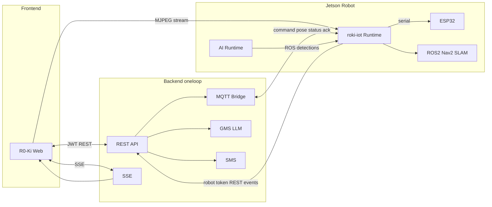
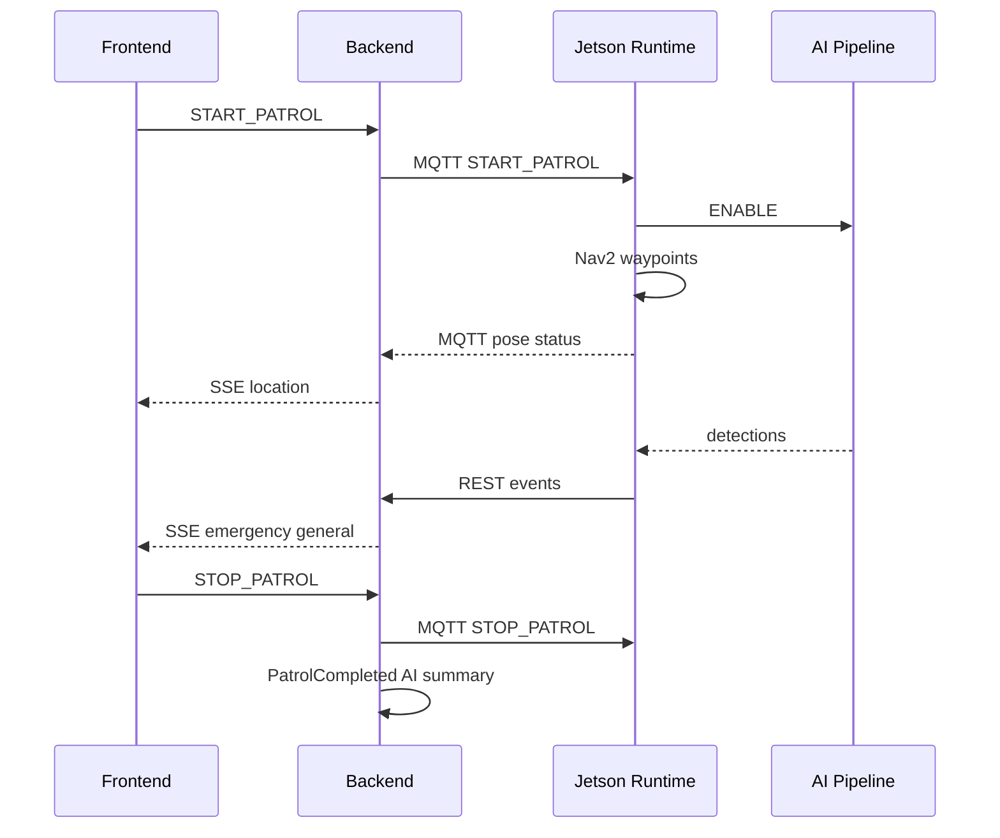

# R0-Ki (한바퀴) — AI 순찰 로봇 관제 플랫폼

아파트 단지를 자율 순찰하는 로봇과, 관리자가 실시간으로 관제·대응하는 웹 플랫폼입니다.

로봇이 LiDAR·카메라로 단지를 돌며 이상 상황을 탐지하면, 관제 화면·알림·통계 인사이트로 이어집니다. Frontend / Backend / IoT(Robot) / AI 네 파트가 하나의 운영 루프로 연결됩니다.

| 구분 | 내용 |
| --- | --- |
| 제품명 | R0-Ki (관제 UI) |
| 서버 | oneloop (Spring Boot) |
| 로봇 런타임 | Hanbakwi / Jetson 통합 프로세스 |
| MQTT 네임스페이스 | `hanbakwi/v1/robots/{robotKey}/…` |

---

## 주요 기능

- **실시간 관제**: 로봇 위치·상태 SSE, MJPEG 라이브 카메라, 긴급/장애물 알림
- **순찰·맵핑**: Nav2 웨이포인트 순찰, 게임패드 SLAM 맵핑 → 지도·구역·경로 온보딩
- **탐지 이벤트**: 사람·쓰레기·재활용 구역·차량(번호판) 탐지 → 증거 이미지·처리 상태
- **입주민 알림**: 등록 차량·연락처 기반 SMS 통지
- **통계·AI 인사이트**: 이벤트 집계 차트 + 주/월 LLM 리포트, 순찰 AI 요약·PDF

---

## 시스템 아키텍처



### 순찰 E2E (요약)



---

## 기술 스택 요약

| 파트 | 핵심 기술 |
| --- | --- |
| Frontend | React 18, TypeScript, Vite, Zustand, Tailwind, R3F/Three.js, Recharts |
| Backend | Spring Boot 4.1, Java 21, JPA, Flyway, MySQL, MQTT, SSE, JWT |
| IoT | Jetson Orin Nano, ESP32, YDLIDAR, ROS 2 Humble, Nav2, SLAM Toolbox, MQTT |
| AI | YOLO26n, PaddleOCR, TensorRT/ONNX(엣지), GMS Chat Completions(서버) |

---

## Frontend

관제 웹앱입니다. 대시보드에서 지도·라이브캠·이벤트를 한 화면에서 보고, 온보딩으로 로봇·맵·경로를 구성합니다.

**강조 포인트**

- Bearer 인증이 포함된 **커스텀 SSE** 스트림 파서 (`fetch` + `ReadableStream`)
- SLAM 월드 좌표 → 그리드 → **아이소메트릭 2.5D** 단지 지도
- 브라우저에서 **MJPEG** 바이너리 파싱·재연결 상태 머신
- AI 인사이트 `PENDING|PROCESSING` **폴링** + 마크다운 리포트·PDF 내보내기
- Three.js 기반 로봇 모델·진단 뷰, 온보딩 구역/웨이포인트 편집

상세·실행·API 표: [frontend/README.md](frontend/README.md)

---

## Backend

아파트·로봇·순찰·이벤트·통계를 관리하는 API 서버(`oneloop`)입니다. 관리자 JWT와 로봇 서비스 토큰을 분리하고, MQTT 텔레메트리를 SSE로 관제에 전달합니다.

**강조 포인트**

- **이원 인증**: 관리자 JWT / 로봇 토큰 (`ROLE_ROBOT`)
- MQTT `pose`·`status`·`command/ack` ↔ 도메인 이벤트 ↔ **SSE**
- 트랜잭션 **AFTER_COMMIT** + 전용 `@Async` 워커: AI 인사이트, 순찰 요약, SMS
- 탐지 이벤트 생성·불법주차(차량) 판정·증거 업로드
- Flyway 마이그레이션, OpenAPI(Swagger)

상세·패키지·플로우: [backend/README.md](backend/README.md)

---

## IoT (Robot)

Jetson에서 동작하는 로봇 런타임입니다. ESP32 시리얼·ROS2 항법·MQTT 백엔드 연동·AI 게이트를 한 프로세스로 묶습니다.

**강조 포인트**

- `run_integrated.py` **composition root** (시리얼 단일 소유)
- **Fail-closed** 안전: LiDAR/AI heartbeat, ESP32 워치독, 속도·ARM 제한
- 순찰 FSM: config/map 검증 → AI ENABLE → Nav2 → DESTINATION STOP → ACK
- 맵핑: 게임패드 deadman + SLAM Toolbox → 지도 업로드
- AI 탐지 → 좌표 투영 → outbox → Backend REST

상세·운영·계약: [robot/README.md](robot/README.md)

---

## AI

엣지 비전(탐지·OCR)과 서버 LLM(요약·인사이트) 두 축입니다. 엣지 추론 결과는 Robot이 REST로만 Backend에 전달하고, LLM은 Backend가 집계 표/JSON으로 호출합니다.

**강조 포인트**

- **YOLO26n** 8클래스 탐지 (사람·쓰레기·통·번호판 등)
- **PaddleOCR** 번호판 인식 (라인 완전일치 기준 검증 Acc 약 0.93 — 상세는 하위 문서)
- Robot↔AI **ROS 계약** (`/ai/control`, `/ai/status`, `/ai/detections`)
- 차량은 엣지에서 미확정 → Backend가 주차·등록 차량 판정
- GMS 기반 순찰 요약·주/월 인사이트 (RAG 없음, 표/JSON 입력)

상세·모델 지표: [ai/README.md](ai/README.md)

---

## 저장소 구조

```text
S15P11E103/
├── frontend/          # R0-Ki 관제 웹
├── backend/           # oneloop API 서버
├── robot/             # Jetson IoT 런타임·하드웨어·ROS 설정
├── ai/                # YOLO·OCR 산출물·문서 (엣지 파이프라인은 Jetson)
├── infra/             # 배포·Jetson 서비스·OTA 관련
├── exec/              # 실행/산출물 보조
└── docs/              # 설계·분석·협업 가이드
    └── collaboration.md
```

---

## 로컬 실행 개요

시크릿·실서버 주소·토큰은 저장소에 넣지 않습니다. 각 파트의 `.env.example`을 복사해 로컬에서만 채웁니다.

| 파트 | 시작점 | 참고 |
| --- | --- | --- |
| Frontend | `frontend/` → `npm install` → `npm run dev` | [frontend/README.md](frontend/README.md), `frontend/.env.example` |
| Backend | `backend/` → Gradle Boot 실행 | [backend/README.md](backend/README.md), 로컬 DB·설정은 예시 파일만 사용 |
| IoT | Jetson + `robot/scripts/run.sh` | [robot/README.md](robot/README.md), env는 Git 제외 |
| AI | 엣지: Jetson AI 서비스 / 서버 LLM: Backend GMS 설정 | [ai/README.md](ai/README.md) |

인프라·Jetson 서비스: [infra/README.md](infra/README.md), [infra/jetson/README.md](infra/jetson/README.md)

---

## 협업 가이드

Jira, GitLab 브랜치, Commit/MR, CI/CD 규칙은 아래 문서를 따릅니다.

→ [docs/collaboration.md](docs/collaboration.md)
