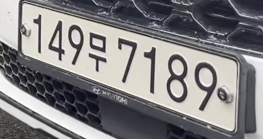
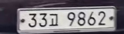
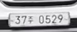
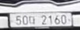
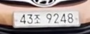

# OCR 모델 (`ai/ocr`)

최종 갱신: 2026-07-21

경로 기준: 저장소 루트의 `ocr/`

---

## 1. 최종 모델 (번호판 인식)

| 항목 | 내용 |
|------|------|
| 경로 | `models/ocr_finetune_rec/` |
| 베이스 | `korean_PP-OCRv5_mobile_rec` |
| 학습 방식 | 사전학습 인식 모델 **전이학습(전 레이어 파인튜닝)** |
| 학습 데이터 | AI Hub 자동차 번호판 _(수량: 팀 확인 후 기입)_ |
| Epoch | 300 |
| Valid Acc | **약 0.93** |

### Valid Acc ≈ 0.93 정의

| 항목 | 정의 |
|------|------|
| 단위 | 번호판(한 줄) 1샘플 |
| 정답 | 예측 문자열 = GT **완전 일치** |
| 오답 | **한 글자라도** 다르면 해당 샘플 전체 오답 |
| 식 | `Acc = 완전일치 수 / 검증 샘플 수` |

문자 단위 부분점수(CER)가 아니라 **라인(시퀀스) 완전일치 정확도**이다.

### 데이터셋 링크

| 데이터 | 용도 | 링크 |
|--------|------|------|
| AI Hub 자동차 번호판 | OCR 파인튜닝 | _(링크 추가)_ |

### Inference 파일

- `inference.json`
- `inference.pdiparams`
- `inference.yml`

---

## 2. YOLO와의 연결 (데모)

서비스가 아니라 **데모 파이프라인**(`pipeline/`, `ai/dev`)에서의 연결 방식이다.

1. **탐지:** YOLO `licence` 클래스로 번호판 박스 예측
2. **추적:** ByteTrack으로 동일 객체에 track id 부여
3. **크롭:** 박스에 padding(~10%)을 두고 crop. 종횡비·경계 등 간단한 품질 필터
4. **인식:** PaddleOCR **TextRecognition만** 호출 (`model_dir=ocr/models/ocr_finetune_rec`)
   - 전체 OCR(검출+인식) 파이프라인은 사용하지 않음
5. **확정:** 같은 track id의 OCR 결과를 여러 번 모아 **다수결**로 최종 번호판 문자열 결정

핵심: **위치는 YOLO, 글자는 파인튜닝 OCR**.

---

## 3. 실행 환경 (개발 PC 참고)

| 항목 | 내용 |
|------|------|
| OS | Windows |
| GPU | RTX 4070 Laptop |
| YOLO | PyTorch CUDA (GPU) |
| OCR | PaddlePaddle (기본 CPU) |
| Python | 3.12.x |

실시간 FPS는 OCR 호출 빈도에 크게 좌우된다.

---

## 4. OCR crop 예시

| crop | 인식 |
|:---:|:---:|
|  | `149무7189` |
|  | `33고9862` |
|  | `37주0529` |
|  | `50다2160` |
|  | `43조9248` |
