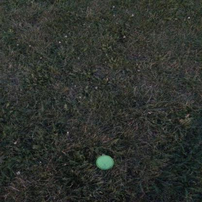
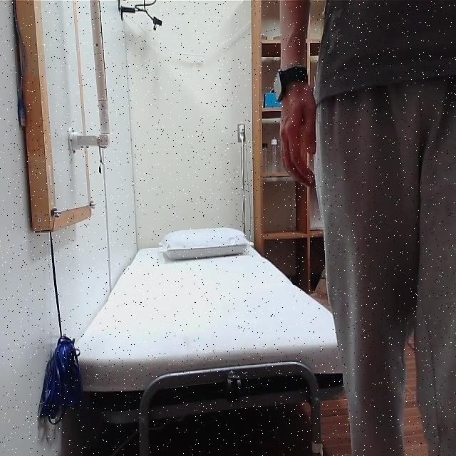
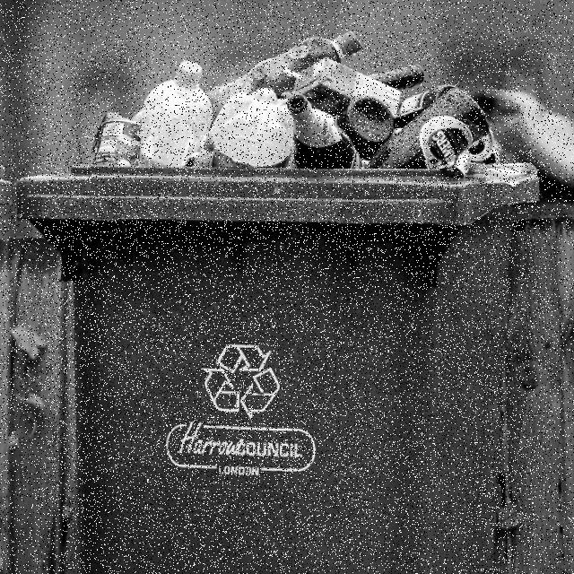
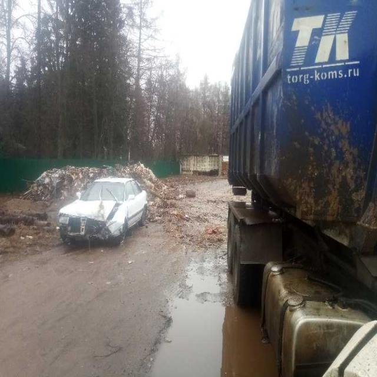
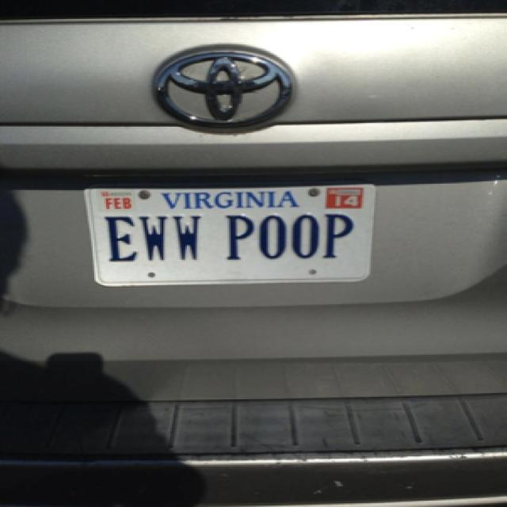
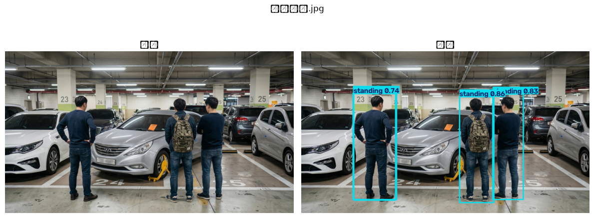
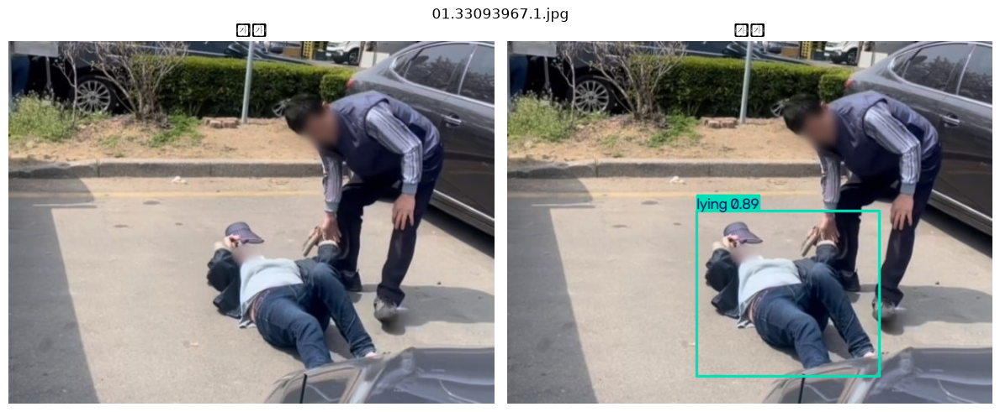
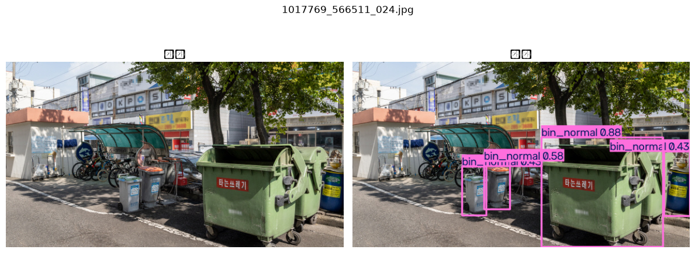
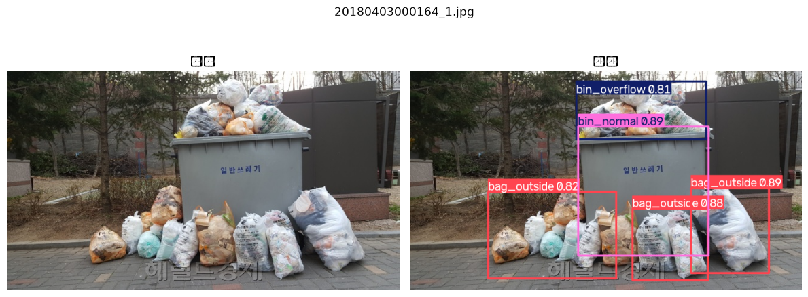
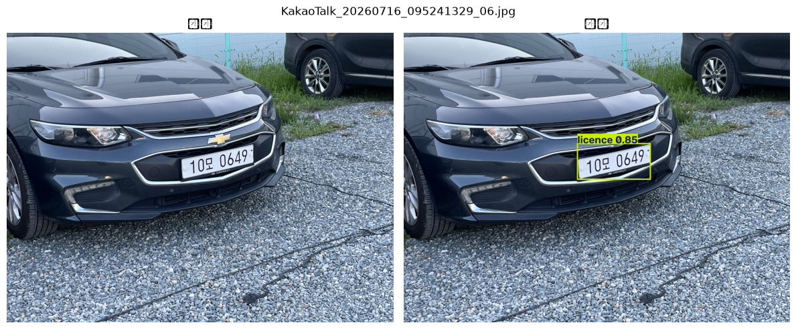

# YOLO 모델 (`ai/yolo`)

최종 갱신: 2026-07-21

경로 기준: 저장소 루트의 `yolo/`

---

## 1. 최종 (v3) — 권장

| 항목 | 내용 |
|------|------|
| 파일 | `checkpoints/v3/best.pt` |
| 베이스 | YOLO26n 사전학습 가중치 |
| 학습 방식 | **전이학습(전 레이어 파인튜닝)** — freeze 없이 전체 레이어 학습 |
| 배치 | 16 |
| 검증 | P 0.886 / R 0.792 / **mAP50 0.86** / mAP50-95 0.603 |

### 클래스

| id | name |
|----|------|
| 0 | small_trash |
| 1 | standing |
| 2 | sitting |
| 3 | lying |
| 4 | bin_overflow |
| 5 | bin_normal |
| 6 | bag_outside |
| 7 | licence |

### 데이터 규모·집계

| 항목 | 내용 |
|------|------|
| 총 규모 | 약 **15,000장** (고유 이미지 수에 가까운 팀 기록) |
| 카테고리별 참고 | 사람 ~9,000 / 쓰레기·통·봉투 ~3,000 / 번호판 ~2,000 / small_trash ~2,000 |
| 중복 집계 | 카테고리별 수는 “해당 클래스가 포함된 이미지 수”에 가깝다. **한 장에 여러 클래스가 있으면 중복 집계**될 수 있어, 단순 합 ≠ 고유 이미지 수일 수 있다. |
| Val | Images 1,113 / Instances 2,275 |

### 데이터셋 링크

| 데이터 | 예시 이미지 | 용도 | 링크 |
|--------|:----------:|------|------|
| TACO (archive) |  | small_trash | [Roboflow](https://universe.roboflow.com/divya-lzcld/taco-mqclx/dataset/3) |
| sitting-standing-lyingv2 |  | standing, sitting, lying | [Roboflow](https://universe.roboflow.com/surgicaldataset-h8qpp/sitting-standing-lyingv2/dataset/4) |
| stand-sit-fall |  | standing, sitting, lying | [Roboflow](https://universe.roboflow.com/swook1015-ijop5/stand-sit-fall/dataset/3) |
| Garbage overflowing |  | bin_overflow, bag_outside | [Roboflow](https://universe.roboflow.com/trash-qdazj/garbage-overflowing/dataset/1) |
| garbage bin | — | bin_overflow, bin_normal, bag_outside | [Roboflow](https://universe.roboflow.com/xiantan-oktzj/garbage-bin-l7frd/dataset/1) |
| trash bin |  | bin_normal | [Roboflow](https://universe.roboflow.com/stairs-ttqqp/trash-bin-asn0s/dataset/1) |
| Car Plate |  | licence | [Roboflow](https://universe.roboflow.com/lilin-y1lc6/car-plate-b4twg/dataset/2) |

---

## 2. v2

| 항목 | 내용 |
|------|------|
| 파일 | `checkpoints/v2/best.pt` |
| 비고 | 자세·쓰레기통 세분화 단계, 전이학습 |
| 데이터 규모 | 약 5,000장 (클래스당 ~1,000 참고) |
| 데이터셋 링크 | _(링크 추가)_ |

---

## 3. v1

| 항목 | 내용 |
|------|------|
| 파일 | `checkpoints/v1/best.pt` |
| 비고 | 초기 3클래스(사람/번호판/쓰레기), ~3,300장 |
| 데이터셋 링크 | _(링크 추가)_ |

---

## 4. 탐지 예시

| standing | lying |
|:---:|:---:|
|  |  |

| bin_normal | bin_overflow |
|:---:|:---:|
|  |  |

통합 시연(Detect+Track+OCR)은 [`pipeline/`](../../pipeline/) 및 루트 [`README.md`](../../README.md)를 참고하세요.
